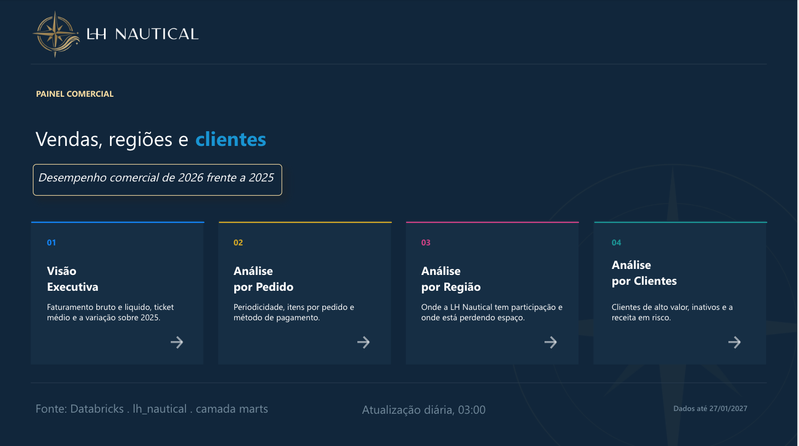
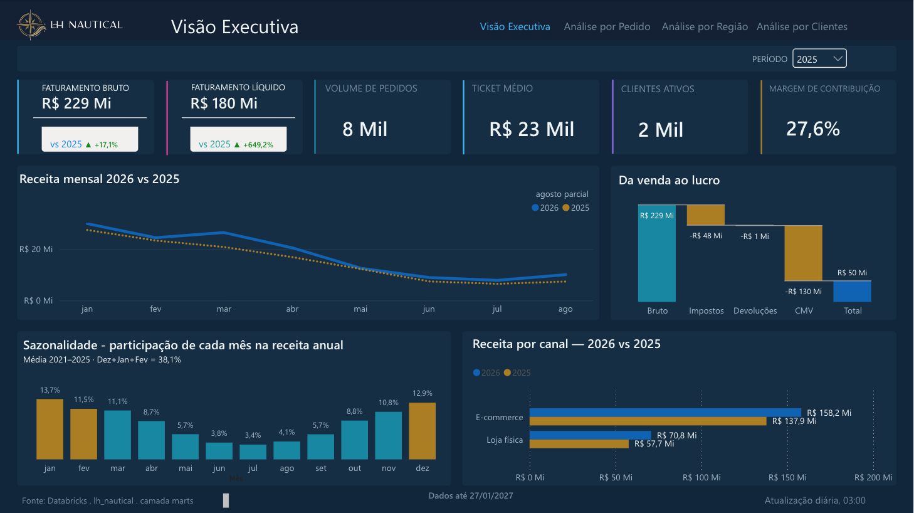
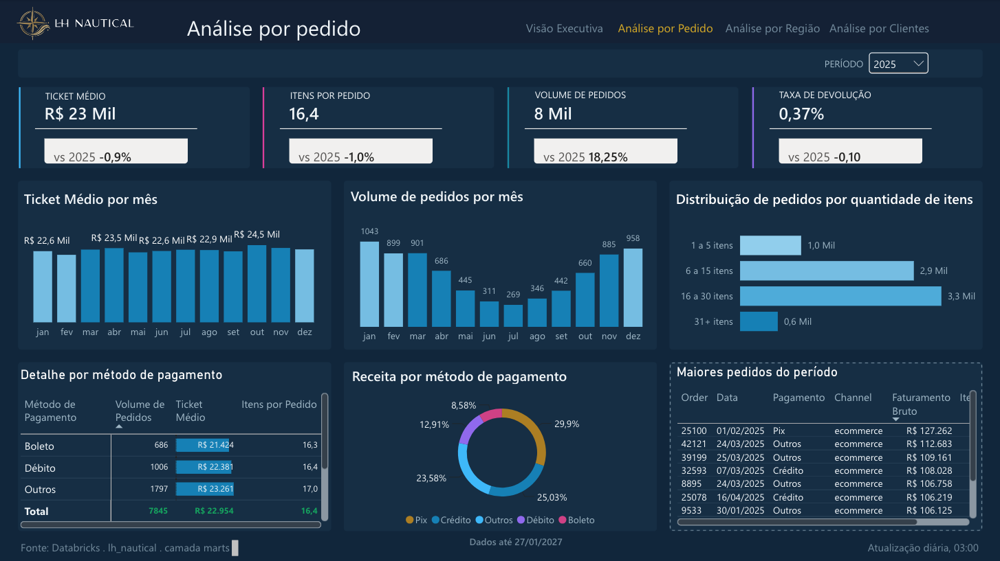
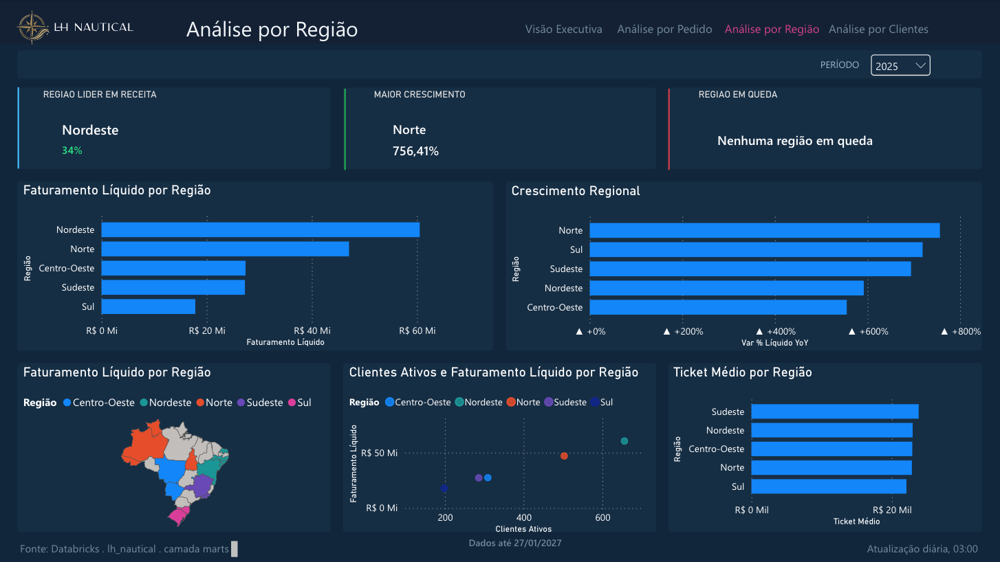
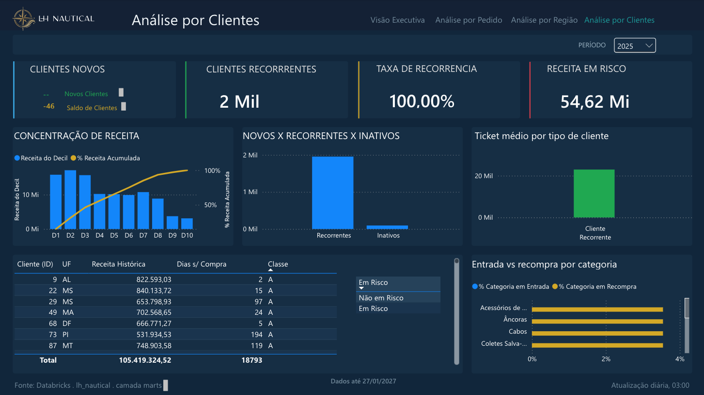

# Executive Dashboard Guide — LH Nautical

## 1. Overview
This is LH Nautical's Executive Dashboard, designed to address strategic pain points of the operation: unifying channels (physical stores and e-commerce), eliminating "phantom profit" and giving real visibility into customer and regional behavior.

## 2. Access, Links and Architecture
* **Dashboard access:** the report was published in the program's Power BI workspace (not public). See the screenshots and the `.pbit` template in `docs/dashboard/`.
* **Restrictions:** Access is controlled through Row-Level Security (RLS) according to the user's hierarchical level.
* **Data source:** Data is consumed directly from Databricks, based on our *Marts* layer generated by dbt (fact, dimension and aggregate tables).
* **Refresh:** Automated pipeline with a daily refresh scheduled for 03:00 AM UTC-3.

## 3. KPI Dictionary (Primary)
* **Gross Revenue** (*Faturamento Bruto*): Total transacted across all channels, with no deductions.
* **Net Revenue** (*Faturamento Líquido*): Actual cash revenue after strictly deducting returns (in the month of the original sale) and taxes.
* **Order Volume** (*Volume de Pedidos*): Distinct count of valid orders (cancelled orders are excluded).
* **Average Ticket** (*Ticket Médio*): Net Revenue divided by Order Volume (never by items or customers).
* **Active Customers, Rolling 12M** (*Clientes Ativos*): Unique buyers with at least one valid order in the last 12 months (window chosen to absorb the seasonality of the nautical summer).
* **Return Rate** (*Taxa de Devolução*): Returned amount divided by Gross Revenue for the same period.

## 4. Page Navigation

### Executive View (*Visão Executiva*)
C-level summary with Revenue, Net Profit, Returns and macro YoY (Year-over-Year) growth indicators.

### Order Analysis (*Análise por Pedido*)
Purchase frequency, average ticket, basket size (items per order) and payment methods.

### Regional Analysis (*Análise por Região*)
Market share, regional strength, customer volume by state and revenue comparison.

### Customer Analysis (*Análise por Clientes*)
ABC curve (identification of high-value customers), retention metrics, new vs. returning customers and churn risk analysis (revenue at risk from inactive customers).

## 5. Support and Ownership
For questions about business rules, bug reports on visuals or data refresh issues, please contact:
* **Tech Lead:** Eva Carrasquel
* **Analytics Engineering:** Gabriel Henrique Silva
* **Data Engineering:** Leonardo Pinho
* **Data Engineering:** Eros Gonçalves
